# Mac Explorer

A native macOS file manager with a Windows 11 File Explorer-style UI. Built from scratch in
Swift/AppKit against the behavioral contract in [docs/REA-spec.md](docs/REA-spec.md), with no web
views, Electron/Chromium components, or third-party dependencies.

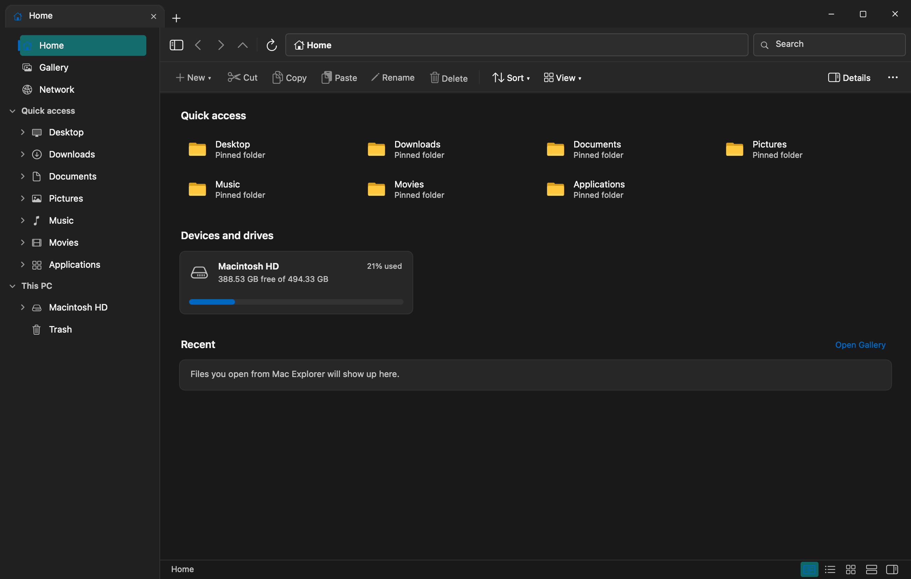
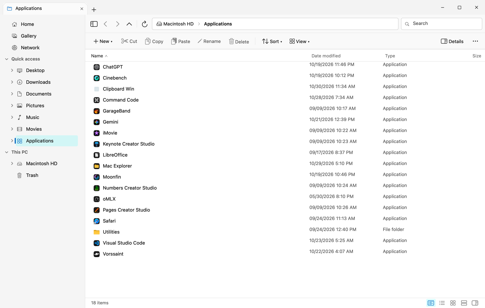
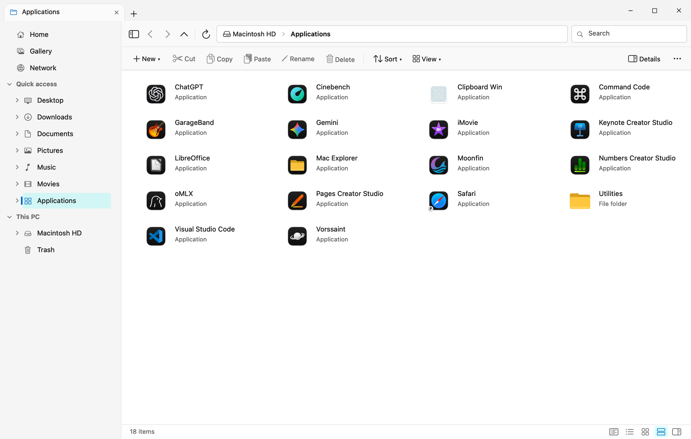
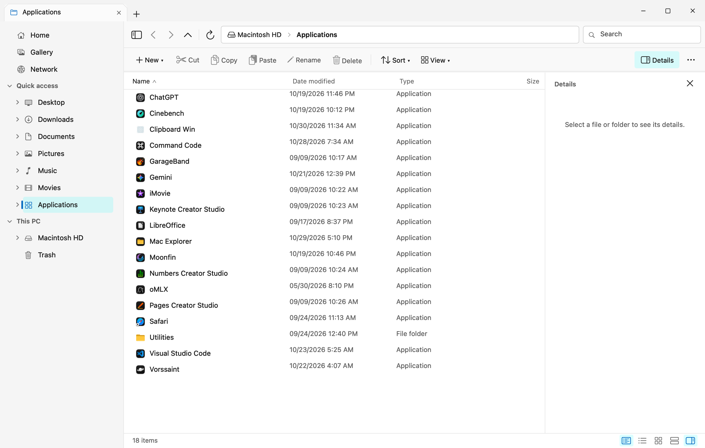
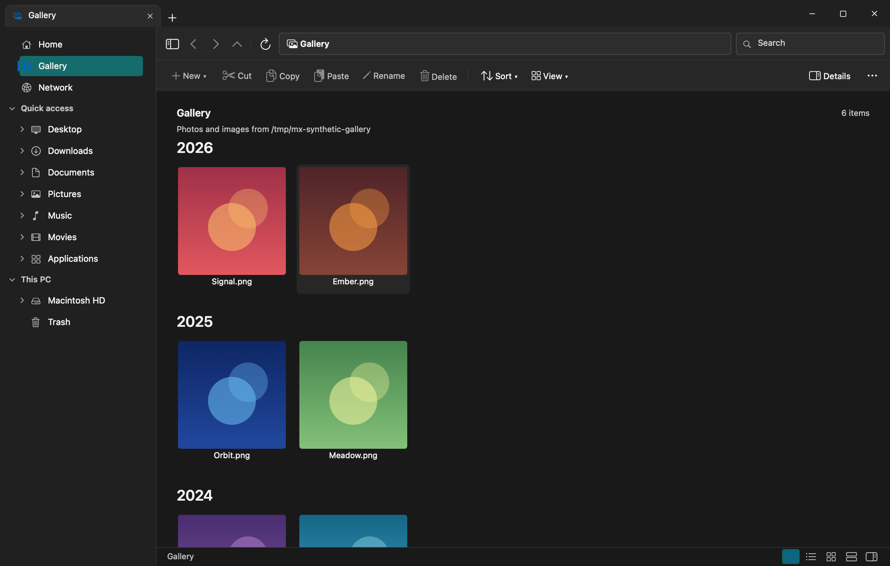
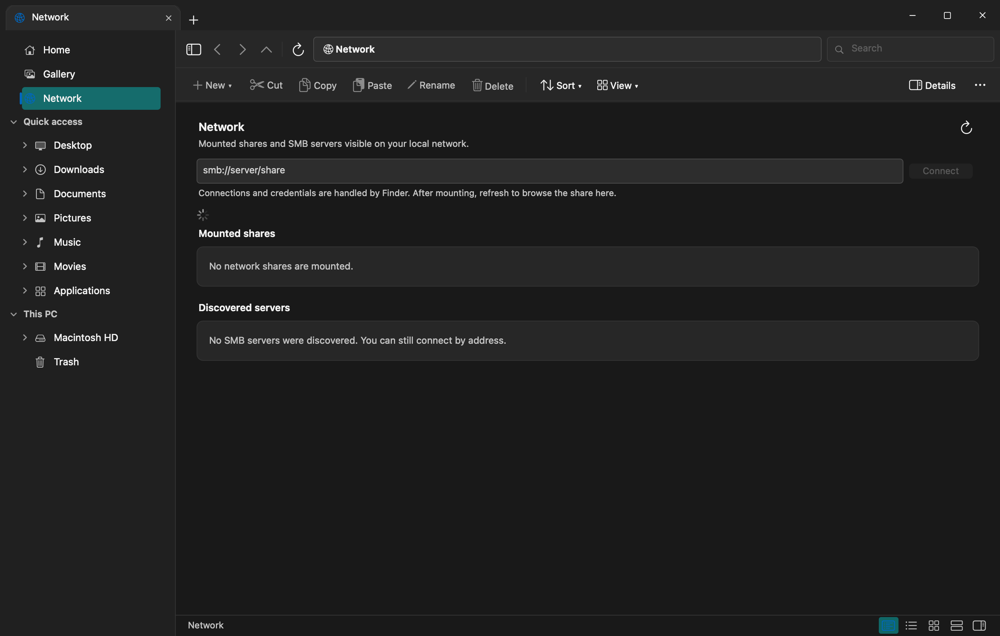
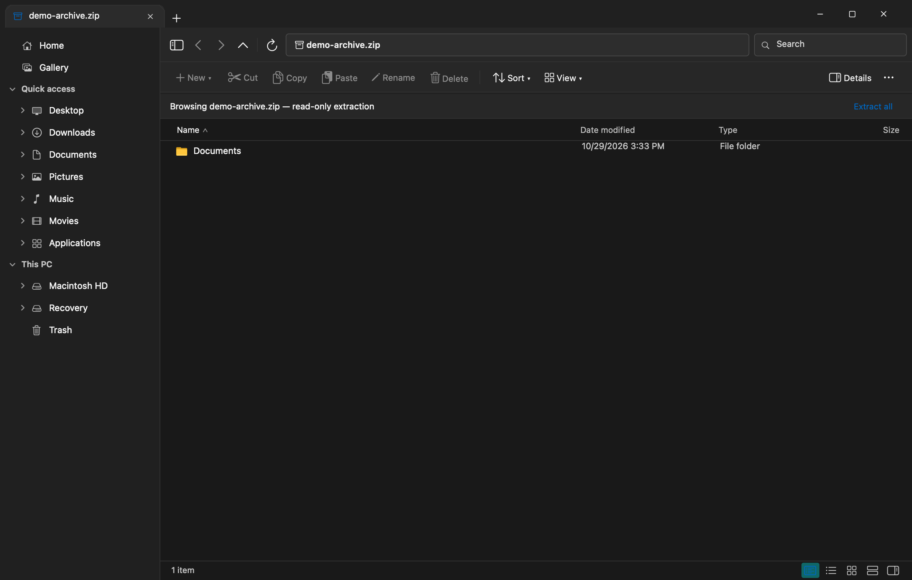
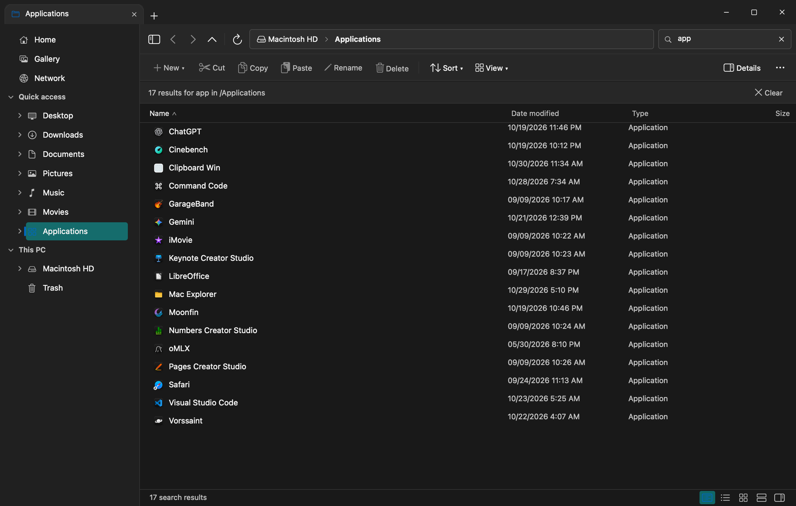
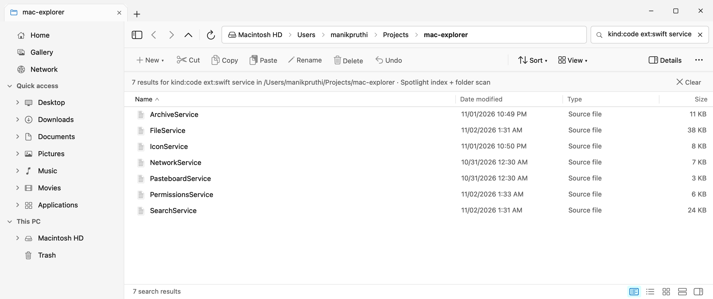
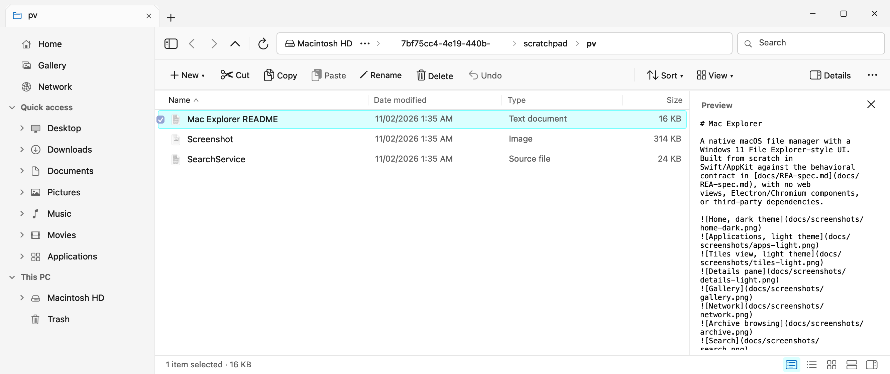
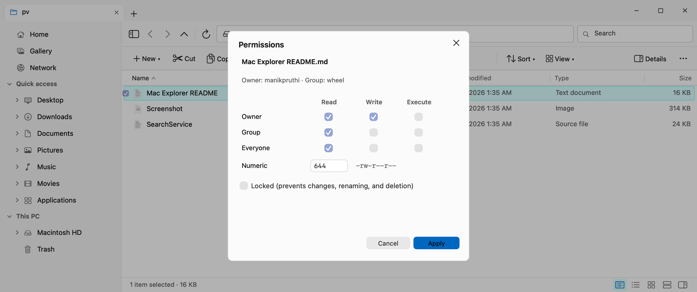
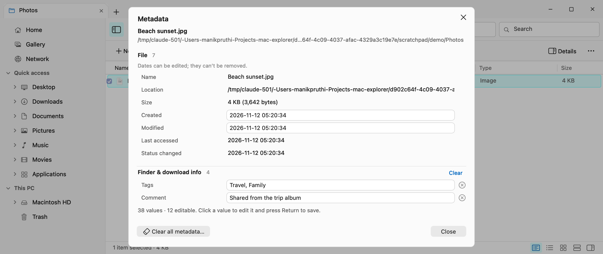
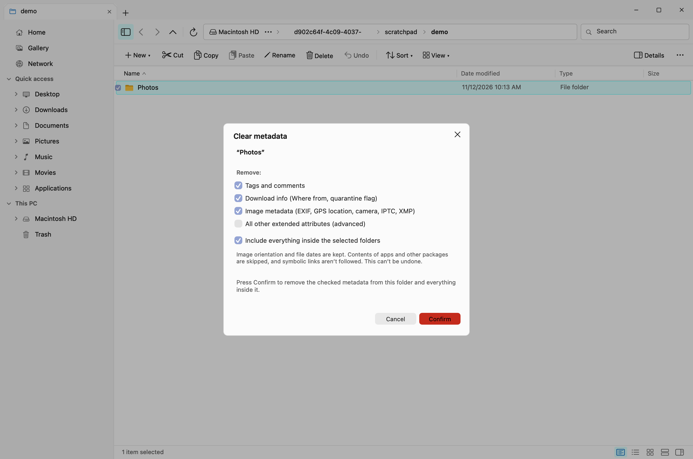
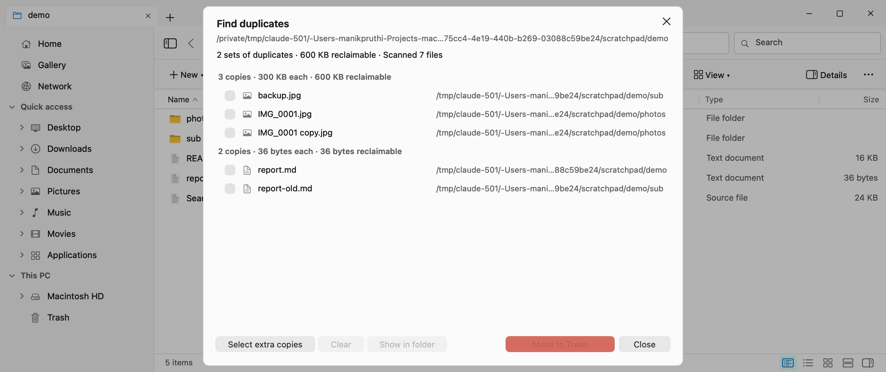

## Features

- **Tabbed browsing** with per-tab path, history, sort, view, selection, and finished search
  results (a search still running when you switch away is dropped). `⌘T`, `⌘W`, middle-click close, drag-out detach, tab context menu with “Move tab to new window”, `⌘N` windows.
- **Navigation bar** with back/forward/up/refresh, clickable breadcrumbs, collapsed long paths, and
  an address bar that switches to edit mode with a single click (`⌘L`, `~` expansion).
- **Windows 11 command bar** — New, Cut, Copy, Paste, Rename, Delete, Undo Delete, Sort, View,
  Details, and an overflow menu with pin-to-Quick-access, theme, terminal, and About.
- **File-aware Cut** from the toolbar, context menu, `⌘X`, and the macOS Edit menu; cut items stay
  dimmed until pasted.
- **Quick access pinning** from any folder’s context menu or the overflow menu. Pins persist and
  expand the navigation pane.
- **Navigation pane** — Home, Gallery, Network, collapsible Quick access with expandable folder
  trees, This PC volumes, and Trash.
- **Home** — pinned Quick access cards, a persisted recent-files list, and a storage overview for
  Macintosh HD and mounted volumes with used/free capacity bars.
- **Gallery** — recursive Pictures scan grouped by year with Quick Look thumbnails.
- **Network** — Bonjour SMB discovery, Finder-owned authentication/mounting, mounted-share browsing.
- **Archive browsing** — ZIP/TAR/GZ/BZ2/XZ and other `bsdtar` formats open in a read-only extracted
  view with breadcrumbs, Up/Back, copy-out, file opening, and Extract All.
- **Drag and drop** — internal drops move onto folders, breadcrumb folders in the address bar, or the
  navigation pane (Option copies); Finder drops copy in. While dragging, the selection shrinks to a
  small icon pile with an item-count badge under the pointer, so the list stays visible, and the
  folder, sidebar entry or breadcrumb under the pointer gets an accent highlight. A folder that is
  part of the drag is never offered as its own target. Dragging any number of selected items
  (including a `⌘A` selection with some items ⌘-clicked off) is safe, and a drag that ends or is
  cancelled over the navigation pane (including one abandoned by another app) no longer crashes.
- **Five views** — Details, Large icons, Medium icons, List, and Tiles. Details has sortable,
  user-resizable columns; every column, Size included, is left-aligned with its header. Columns can be dragged wider
  or narrower freely; the Name column fills the pane while the columns fit, and once they are
  wider than the pane the list scrolls horizontally. Dragged widths survive refreshes. Large/medium
  icon captions are centred under their icons.
- **Explorer selection model** — click, ⌘-toggle, Shift range, arrows, type-ahead, rubber-band
  (marquee) drag selection with live row/icon highlighting and edge auto-scroll (the anchor stays
  pinned to the content while it scrolls, and quick repeat drags or background refreshes no longer
  drop the marquee), checkbox hit targets, and `⌘A`. Hover shading follows the pointer and clears
  on scroll, reload, drag, or window switch.
- **Live updates** — the active folder refreshes automatically when files are added, removed,
  renamed, or changed by other apps, and the navigation pane and Home update when volumes mount,
  unmount, or eject.
- **Volume ejection** — eject mounted disk images, removable media, and network volumes from the
  navigation pane or the Home volume cards.
- **Details pane** with previews, metadata, quick actions, and a multi-selection summary.
- **Preview pane** (`⌥⌘P`, View menu, or the command bar’s View ▾ / ⋯ menus) — a Windows-style
  live preview of the selected file (documents, PDFs, images, video, source code, and anything else
  Quick Look renders). It shares the right-hand slot with the Details pane (opening one closes the
  other), waits ~120 ms while you arrow through files, and releases its renderer when closed.
- **Permissions editor** — **Permissions…** from the file context menu, the File menu, or the
  Properties dialog. Owner/Group/Everyone read-write-execute checkboxes kept in sync with a numeric
  (octal) field and `rwxr-xr-x` display, plus the Finder **Locked** flag. For folders, **Apply to
  enclosed items** walks the tree without following symlinks; enclosed files only keep execute bits
  if they were already executable. Properties shows the current permissions, owner, and group.
- **Metadata editor** — **Metadata…** from a single item's context menu or the File menu (a
  separate dialog from Permissions). It lists everything known about the item in sections: **File**
  (name, location, size, created/modified/accessed dates), **Finder & download info** (tags,
  Spotlight comment, “Where from” URLs, quarantine), embedded image metadata split into **EXIF**,
  **GPS**, **TIFF**, **IPTC**, and **XMP**, raw **Extended attributes**, and the read-only
  **Spotlight** record. Click a value to edit it (dates as `yyyy-MM-dd HH:mm:ss`, tags and keyword
  lists comma-separated) and press Return to save; ⓧ removes one value, each section's **Clear**
  removes that section, and **Clear all metadata…** removes everything removable after an inline
  confirmation. Image edits copy the picture data instead of re-encoding it (JPEG, HEIC); PNG/TIFF
  fall back to a lossless rewrite. Each write is checked on a temp copy before it replaces the
  original, so a format that won't drop a field reports it and leaves the file untouched.
  Orientation and pixel-layout fields are kept by Clear so photos never turn sideways, and image
  rewrites keep the file's created/modified dates. The label column sizes itself to the longest
  field name.
- **Clear metadata in bulk** — **Clear metadata…** from the context menu of several selected items
  or any folder (or **File ▸ Clear Metadata…**). Choose what to remove — tags and comments,
  download info (Where from, quarantine), image metadata (EXIF/GPS/IPTC/XMP), and optionally all
  other extended attributes — and whether to include everything inside selected folders. Nothing
  changes until you press **Confirm**; progress is shown live, **Stop** ends the run part-way, and
  the summary reports how many items were checked, how many were cleared, how many had nothing to
  remove, and any that couldn't be changed. Folders are
  walked lazily one item at a time; symlinks aren't followed, the contents of apps and other
  packages are skipped, and attributes macOS protects (`com.apple.provenance`, `com.apple.macl`)
  are left alone.
- **Find duplicates** — from the ⋯ menu, File menu, folder background menu, or a folder’s context
  menu. Files are grouped by size, then by a 16 KB head hash, then confirmed with a full SHA-256, so
  only same-size candidates are ever read. Hard links and empty files are not reported. Results show
  each set with reclaimable space; **Select extra copies** marks all but the shortest-path copy, and
  **Move to Trash** refuses to remove every copy of a set (Undo Delete restores them). Double-click
  opens a file; **Show in folder** jumps to it.
- **Quick Look** — press `Space` on a selected file to preview it in the system Quick Look panel,
  like Finder. `Space` or `Esc` closes it, arrow keys browse the folder, and `Enter` opens the
  previewed file. The context menu also offers Quick Look, though the `Space` shortcut is faster.
- **Real file operations** — create folder/text file, inline rename, copy/cut/paste with Windows-style
  unique names, move to Trash, restore and empty Trash, compress to ZIP (a single item is
  compressed with `ditto`, like Finder, keeping extended attributes and resource forks; multiple
  items keep symlinks as links and are stored relative to their shared folder), permanent delete
  (confirmed), recursive properties with real size on disk (hard links counted once, “At least…”
  when a very large folder hits the scan limit), Show in Finder,
  and Open in Terminal. **Undo Delete** restores the last Trash operation (single level) from the
  command bar, the file context menu, or `⌘Z`; it stays available across launches while the trashed
  files still exist, and disables after a permanent delete or when the Trash copies are gone. The
  context menu also offers **Open with**, including a compatible-app submenu (the current default
  is checked) and an “Other…” application chooser. Its **Always open .ext files with** submenu
  changes the system-wide default app for that file type, like Finder’s Get Info › Change All,
  after a confirmation that lists every extension the change covers (`.jpg` also changes `.jpeg`
  and `.jpe`); unknown extensions can be assigned through its “Other…” chooser. It is hidden for
  files without an extension. The context menu also has a **Share** submenu with all installed
  share extensions (AirDrop, Mail, Messages, Notes, Reminders, and more) and, as its first item,
  **Quick Share**, which sends files
  to nearby Android phones via [QuickShare-Mac](https://github.com/manikpruthi/quickshare-mac)
  using a `quickshare://send` handoff (no document-open handoff; HTML and every other file type work).
  Below it, **Email with Mac Mail** opens a new message in Mac Mail (the companion mail app) with the selected
  files already attached (folders are zipped first); it shows a toast if Mac Mail isn't installed.
- **Shared file clipboard** — file URLs are published to `NSPasteboard` for Finder interop; internal
  cut intent never leaves the app.
- **Indexed, scoped search** — queries the macOS **Spotlight index** for the current folder first
  (deep results in milliseconds, shown immediately), then merges in a bounded breadth-first folder
  walk that finds hidden and unindexed items. Results are ranked (exact name, prefix, word start,
  then anywhere; shallower first) before the 250-result cap is applied, and a new keystroke cancels
  the previous search. Matching is case- and accent-insensitive (`resume` finds `Résumé.pdf`).
  App/package bundles are treated as opaque; `~/Library`, `/Library`, `/System`, and `/private` are
  skipped by path, so project folders that happen to be named `Library` are still searched. See
  [Search syntax](#search-syntax).
- **Safe extension hiding** — with extensions hidden, executables (`.app`, `.exe`, `.pkg`, `.sh`, …)
  and double extensions (`invoice.pdf.exe`) always show their real extension.
- **Light, dark, and system themes**, accent `#0067C0` selection, Windows-style window buttons with
  hidden traffic lights, a Dock icon with balanced transparent margins, draggable title strip,
  double-click zoom, and persistent window bounds.
- **Complete keyboard map** (below) plus a native File/Edit/View/Window menu bar.

## Requirements

- macOS 14 or later (Apple Silicon or Intel — the DMG is a universal binary)
- Nothing else to install if you use the prebuilt DMG
- To build from source: Xcode 16+ to open/build the Xcode project, or just the Command Line
  Tools for `build.sh`
- No third-party dependencies or services

## Install

### Easy mode — use the prebuilt DMG (no Xcode needed)

1. Download **[`release/Mac-Explorer-1.6.1.dmg`](release/Mac-Explorer-1.6.1.dmg)**
   (universal: Apple Silicon and Intel).
2. Double-click the DMG to mount it.
3. Drag **Mac Explorer.app** onto the **Applications** shortcut in the window.
4. Open **Applications**, then **right-click Mac Explorer.app → Open** and confirm
   **Open** on the warning. (The app is ad-hoc signed, not notarized, so macOS blocks a plain
   double-click on first launch.)
   - If the prompt only offers **Done** / no **Open** button, use
     **System Settings → Privacy & Security → Open Anyway** instead.
5. Grant **Full Disk Access** when asked — see [Full Disk Access](#full-disk-access).

To eject the installer afterward, click the eject icon beside *Mac Explorer* in Finder’s sidebar.

### Build from source

```bash
./build.sh                  # Debug build -> "$HOME/Library/Caches/MacExplorerBuild/Mac Explorer.app"
./build.sh release          # Optimized Release build
open "$HOME/Library/Caches/MacExplorerBuild/Mac Explorer.app"
./package.sh                # Release build + DMG and ZIP under release/
```

CLI builds go to `~/Library/Caches/MacExplorerBuild` so Spotlight and the macOS Apps view don't
list a second copy alongside the installed app. Set `MAC_EXPLORER_BUILD_DIR` to override it.
`package.sh` writes `release/Mac-Explorer-1.6.1.dmg` and `release/Mac-Explorer-1.6.1.zip`; both
are committed to the repo so the DMG route above works without building anything. The app is
unsigned. On first launch, right-click **Mac Explorer.app → Open**, or allow it under
**System Settings → Privacy & Security → Open Anyway**.

The Xcode project is `MacExplorer.xcodeproj` with the shared scheme `MacExplorer`
(macOS 14 deployment target, bundle id `tools.macexplorer`). `build.sh` is the canonical
build for machines with only the Command Line Tools.

### Full Disk Access

macOS protects `~/.Trash` and other locations from third-party apps. Grant **Full Disk Access** in
**System Settings → Privacy & Security → Full Disk Access**. The app links directly to that pane
from permission errors and from failed file operations. Mac Explorer uses bundle id
`tools.macexplorer` and needs its own TCC grant.

Local network access uses `NSLocalNetworkUsageDescription` and the `_smb._tcp` Bonjour service
declared in `Resources/Info.plist`.

## Keyboard shortcuts

| Shortcut | Action |
| --- | --- |
| `⌘T` / `⌘W` | New tab / close tab |
| `⌘N` | New window |
| `⌘[` / `⌘]` | Back / forward |
| `⌘↑` / `⌘↓` | Up one folder / open focused item |
| `⌘F` / `⌘L` | Focus search / edit address |
| `⌘C` / `⌘X` / `⌘V` | Copy / cut / paste files (or text in fields) |
| `⌘A` | Select all |
| `⌘⇧N` | New folder (opens straight into rename) |
| `F2` | Rename |
| `⌘⌫` or `Delete` | Move to Trash |
| `⌘Z` | Undo Delete (restore the last Trash operation) |
| `Backspace` (nothing selected) | Go back / up one folder |
| `⇧Delete` | Delete permanently (with confirmation) |
| `⌘I` | Properties |
| `⌥⌘P` | Preview pane |
| `⌘R` | Refresh |
| `Enter` | Open focused item |
| `Space` | Quick Look selected file (Space/Esc closes) |
| `↑ ↓ ← →` | Move selection |
| `Esc` | Clear search/selection, cancel address edit |

Drag a tab outside the window (or right-click it) to move it into a new window. Drag files onto
folders to move them; hold Option to copy. Dropping files from Finder copies them into the target.

## Search syntax

Type in the search box (`⌘F`) to search the current folder and its subfolders. Plain words must all
appear in the name; everything is case- and accent-insensitive. Hover the box for a reminder.

| Query | Finds |
| --- | --- |
| `invoice 2025` | Names containing both words |
| `*.pdf`, `IMG_????.jpg` | Wildcards (`*` any run, `?` one character) matched against the whole name |
| `"annual report"` | The exact text, including spaces or `*` |
| `kind:image` | `folder`, `image`, `video`, `audio`, `pdf`, `document`, `word`, `spreadsheet`, `presentation`, `archive`, `code`, `text`, `app`, `font`, `disk` |
| `ext:swift`, `ext:jpg,png`, `type:heic` | File extensions |
| `size:>10MB`, `size:<=500kb`, `size:large` | Sizes (`>`, `>=`, `<`, `<=`, `=`; B/KB/MB/GB) or Windows buckets `empty`, `tiny`, `small`, `medium`, `large`, `huge`, `gigantic` |
| `modified:today`, `modified:week`, `modified:>2025-01-01` | `today`, `yesterday`, `week`, `month`, `year`, or a `yyyy-MM-dd` date with an optional comparison (`datemodified:` also works) |
| `content:quarterly` | Files whose text contains the word (Spotlight; text/code files in unindexed folders) |

Filters combine, e.g. `kind:pdf size:>1MB modified:month tax`. Unknown `key:value` words are
searched as plain text. The results header shows “Spotlight index + folder scan” when the index was
used.

## Architecture

- `Sources/App/` — `main.swift`, `AppDelegate` (window registry, menus, activation), screenshot and
  UI-test harnesses.
- `Sources/Models/` — verbatim Swift port of `shared/types.ts` and `shared/filekinds.ts`, sorting and
  formatting helpers.
- `Sources/Services/FileService.swift` — parallel directory listings, bounded and cancellable search/gallery scans,
  unique-name copy/paste, EXDEV moves, trash/delete guards, recursive properties, system info,
  and volume ejection.
- `Sources/Services/DirectoryWatcher.swift` — FSEvents-based live refresh for the active folder,
  using directory-level events filtered off the main thread.
- `Sources/Services/ArchiveService.swift` — `bsdtar`-via-`Process` extraction with traversal,
  entry-count, and uncompressed-size checks from a single listing pass (symlink targets are resolved
  from the link's folder, so in-archive links like `bin/x -> ../lib/x` are allowed and only links
  that are absolute or climb out of the archive are refused); temp cache with 7-day
  cleanup of archives not opened recently. Extract All writes straight to the destination.
- `Sources/Services/NetworkService.swift` — `NetServiceBrowser` SMB discovery and in-process
  mounted volume inspection via `FileManager.mountedVolumeURLs`; Finder owns SMB auth and mounting.
- `Sources/Services/SearchService.swift` — search query parser (wildcards, quoted phrases, filters),
  Spotlight `MDQuery` lookup scoped to the current folder, the bounded folder walk, merging, and
  relevance ranking.
- `Sources/Services/MacMailHandoff.swift` — "Email with Mac Mail": opens the selected files with Mac Mail, which starts a new message with them attached.
- `Sources/Services/PermissionsService.swift` — `lstat`/`chmod`/`chflags` permission reads and
  writes, owner/group names, Locked flag handling, and recursive apply.
- `Sources/Services/MetadataService.swift` — metadata reads/writes and the streamed bulk clear: `lstat` dates and
  `setAttributes`, Finder tags via `NSURL` resource values, `getxattr`/`setxattr`/`removexattr`,
  ImageIO `CGImageMetadata` tags with `CGImageDestinationCopyImageSource` rewrites through a
  verified temp file, and `MDItem` Spotlight attributes.
- `Sources/Services/DuplicateFinder.swift` — size bucketing, head hashing, and streamed SHA-256
  comparison for Find duplicates.
- `Sources/Services/PasteboardService.swift` — `NSPasteboard` file-URL publishing and change-count
  ownership tracking for internal cut intent.
- `Sources/Services/IconService.swift` — per-type `NSWorkspace` icons for documents (per-path for
  apps, folders, and extensionless files), Retina-scale Quick Look thumbnails, bounded
  `NSCache` storage, and inset Dock icon rendering.
- `Sources/Services/AppStore.swift` — persisted preferences, pins, recents, window state, and the
  last Trash receipt (`lastDeleted`) used by Undo Delete, under
  `~/Library/Application Support/Mac Explorer`. Writes are debounced and done off the main thread,
  with a synchronous flush on quit.
- `Sources/UI/` — programmatic AppKit: window chrome, tabs, navigation/command/status bars, sidebar,
  file views, Home, Gallery, Network, details and preview panes, Quick Look preview, dialogs
  (Properties, Permissions, Metadata, Clear metadata, Find duplicates), menus, and theme.

There are no storyboards or XIBs. The only subprocesses are `/usr/bin/bsdtar`, `/usr/bin/ditto`,
`/usr/bin/zip`, and `NSWorkspace` handoffs to Finder/Terminal.

## Performance

Measured Release build, one process (macOS `footprint`, the metric behind Activity Monitor's
memory column; `ps` RSS is higher only because it counts shared framework pages):

```bash
footprint "$(pgrep -x MacExplorer | head -1)" | grep phys_footprint
# 36 MB idle Home · 41 MB details view · 48 MB with the details pane (1.4.0, release build)
```

The real memory cost stays low even with 16 MB of thumbnails cached. (`ps` RSS reports
~113 MB idle — that includes reclaimable shared-cache pages and double-counts framework code
mapped into every AppKit app.) Techniques used:

- Directory metadata is statted in one parallel pass, with a single `lstat` per item (symlinks
  get one extra `stat`).
- Each tab caches its filtered, sorted listing; selection and focus changes refresh only the
  affected rows/items instead of reloading the whole view.
- Live refresh uses directory-level FSEvents (no per-file event flood from busy subtrees), and
  folder changes don't restart a search that is showing; the listing reloads once search is cleared.
- Quick Look thumbnails and workspace icons live in bounded `NSCache` instances (8 MB icons,
  16 MB thumbnails); large folders do not inflate memory.
- The file list, details pane, Gallery, and Network views are created lazily and released when you
  leave them. Inactive tab listings are released too and reload when the tab is shown again, since
  only the active folder is watched for changes.
- Window chrome (archive banner, search header, content view) is only rebuilt when its structure
  changes; otherwise the existing views update their text in place. The navigation pane keeps its
  nodes (and your expanded subfolders) across navigation and re-reads a folder's subfolders each
  time it is expanded.
- Icon grid and tiles are `NSCollectionView`s that create items on demand; details/list use reusable
  `NSTableView` cells.
- Search and Gallery scans have result caps (`250`/`160`), depth limits, and a 6-second deadline.
- Search keeps no index of its own: it asks the system Spotlight index (which lives in
  `mds`, not in this process) and holds nothing between searches.
- The preview pane and the Permissions/Metadata/Clear metadata/Find duplicates dialogs are created on demand and
  released when closed. The Metadata dialog reads values off the main thread with no cache, reads
  image headers only (no pixel decode, except a one-off PNG/TIFF rewrite), summarizes extended
  attributes over 64 KB instead of loading them, and creates rows only for what is visible. Duplicate scanning keeps only paths and sizes, reads candidates through one reused
  1 MB buffer, and stops at 200,000 files or 2 minutes.

Release 1.4.0 vs 1.3.0, same machine and scenarios (`footprint`, launched with throwaway state):

| Scenario | 1.3.0 | 1.4.0 |
| --- | --- | --- |
| Idle Home | 36 MB | 36 MB |
| Details view of a folder | 41 MB | 41 MB |
| Details pane open | 47 MB | 48 MB |
| Preview pane open (Markdown file) | — | 44 MB |
| Indexed search showing results | — | 44 MB |
- There are no web views or Chromium helpers anywhere in the app.

## Verification

```bash
APP="$HOME/Library/Caches/MacExplorerBuild/Mac Explorer.app/Contents/MacOS/MacExplorer"

# 75 filesystem, archive (including symlink-target checks), sorting, volume, search-query, duplicate, permission, metadata (dates, tags, comment, xattrs, JPEG GPS clear and field edit, recursive bulk clear that skips packages, kept file dates, stopping, macOS-managed attributes read-only), default-app,
# and safety assertions
"$APP" --self-test

# 60 live-controller assertions: navigation, all five views, sorting, toggles,
# create/rename/copy/cut/paste (including same-folder cut as a no-op), Undo Delete, marquee selection, Open with (and its default-app
# submenu), button titles fitting without truncation in every view and dialog, address editing,
# search (header shows the final count; switching tabs mid-search), dialogs, tabs, keyboard map, Quick Look (keyboard + menu), theme,
# and menu-bar routing
"$APP" --ui-test

# In-app snapshot capture (works without Screen Recording permission)
"$APP" --screenshot /tmp/mac-explorer.png --screenshot-exit
```

Screenshots in `docs/screenshots/` were generated with the same harness at 2× scale. The capture
flags used for documentation include `--location`, `--archive`, `--gallery`, `--network`,
`--gallery-root`, `--view`, `--theme`, `--details`, `--preview`, `--select-first`, `--search`,
`--properties`, `--permissions`, `--metadata`, `--clear-metadata`, and `--duplicates`.

Manual end-to-end checks performed: launch to Home, address-bar navigation, breadcrumbs,
create/rename/copy/cut/paste, Trash and permanent-delete guards, search, tabs and tab close,
archive browsing and Extract All, Network discovery view, Gallery thumbnails, Properties, About,
theme switching (light/dark/system), and the full keyboard/menu map.

## Known limitations

- The packaged app is unsigned; use right-click **Open** on first launch.
- Trash and protected locations depend on Full Disk Access.
- Archive views are read-only extracted copies. Encrypted archives and formats unsupported by
  macOS `bsdtar` will not open.
- Network shares are discovered over Bonjour and mounted through Finder; credentials never enter
  the app.
- No drag-out to Finder (drops from Finder copy in, internal drags move). Finder receives copied
  files but not Windows-style cut intent.
- Copies made from inside an archive publish the extracted cache path to the clipboard. Paste into
  a real folder promptly, or use **Extract All** for a permanent copy.
- Documents show the standard icon for their file type; custom icons assigned to individual
  documents in Finder are not shown (apps and folders are unaffected).
- Search relies on Spotlight for deep and content results. Folders excluded from Spotlight (or on
  unindexed volumes and archives) are covered by the folder walk only, whose `content:` matching
  reads UTF-8/Latin-1 text and source files up to 4 MB.
- The permissions editor can only change items you own; it never asks for administrator rights and
  cannot change the owner or group. ACLs are not shown or edited.
- Attributes macOS manages itself (`com.apple.provenance`, `com.apple.macl`, `com.apple.system.*`)
  are shown read-only: the system re-adds them, so neither dialog removes them.
- The Metadata dialog edits one item at a time (bulk is clear-only). Spotlight values are read-only (Spotlight rebuilds
  them), dates can be edited but not removed, and binary extended attributes can only be removed.
  Some embedded fields (structured or language-alternative XMP such as `dc:description`) can be
  removed but not edited. The comment is written as the Spotlight comment attribute; Finder's Get
  Info may keep showing an older comment it cached in `.DS_Store`.
- Find duplicates stops after 200,000 files or 2 minutes and then reports partial results.
- **Always open … with** changes the default per content type, so it applies to every extension
  of that type. macOS sometimes adds its own “change default app?” prompt after the in-app
  confirmation; the change applies only once you accept it there, and declining it changes
  nothing. macOS has no API to remove a default once set, only to pick another app. It is not
  offered for extensionless files (`Makefile`, `README`), whose per-file handler macOS may resolve
  differently from the type default.
- No cloud/OneDrive integration, bulk rename, or permission elevation.
- macOS platform semantics (TCC prompts, Finder auth) take precedence over Windows quirks.

Not affiliated with Microsoft. Windows and File Explorer are trademarks of Microsoft Corporation.

## Provenance

Mac Explorer is an **original project, not a fork**. It is written from scratch in Swift/AppKit.
The UI follows publicly documented Windows 11 File Explorer behavior and the behavioral contract in
[docs/REA-spec.md](docs/REA-spec.md); no source code, web views, Electron/Chromium components, or
bundled assets from another file manager are included.

## License

MIT — see [LICENSE](./LICENSE).
